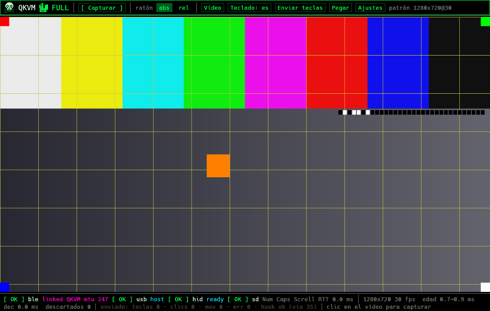
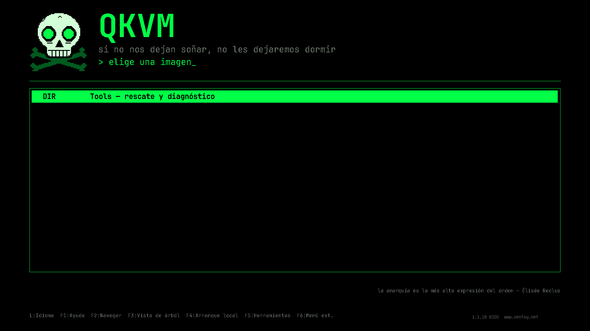

# RiotKVM

> *si no nos dejan soñar, no les dejaremos dormir*

**KVM de bolsillo** para manejar un servidor o PC físico como si estuvieras delante: BIOS/UEFI, menú de arranque, instalar un sistema desde una ISO o rescatar un equipo sin red. Sin agente, sin red y sin instalar nada en la máquina controlada.



## Pensado para que lo maneje una IA

RiotKVM está diseñado para que **un agente de IA controle una máquina física**, no solo una persona. El servidor MCP (`riotkvm-mcp`) le da a un LLM como Claude ojos y manos sobre el equipo: **ve la pantalla** con la capturadora y **teclea y mueve el ratón** a través del dongle, igual que lo haría alguien sentado delante.

Así un agente puede hacer lo que no se puede por SSH ni RDP:

- entrar en la BIOS/UEFI, cambiar el orden de arranque o activar la virtualización;
- arrancar desde la microSD e instalar un sistema operativo de principio a fin;
- rescatar un equipo colgado o sin red desde la consola;
- seguir un procedimiento paso a paso y comprobar cada paso con una captura.

El bucle es siempre **captura → decidir → actuar → captura para verificar**. El MCP usa *Code Mode*: el modelo escribe JavaScript contra la API `riotkvm` (`screenshot`, `type`, `key`, `mouse`, `led`…) dentro de un sandbox con plazos, cancelación y una lista blanca de comandos, así que agrupa varias acciones en una sola llamada sin acceso al portátil. La persona sigue al mando: el agente debe pedir confirmación antes de cualquier acción irreversible (borrar discos, guardar la BIOS, reinstalar o apagar).

## Cómo funciona

```
 portátil ── Bluetooth LE ──▶ dongle RiotKVM ── USB ──▶ servidor
    ▲                         (teclado + ratón + microSD)    │
    └──────────── capturadora HDMI → USB ◀───────── HDMI ────┘
```

- **Dongle** (LilyGO T-Dongle-S3, ESP32-S3) enchufado al servidor: se presenta como **teclado y ratón USB** (relativo y absoluto) y como **pendrive** con la microSD (Ventoy).
- **Capturadora HDMI → USB** en el portátil para ver la pantalla del servidor.
- **Cliente** en el portátil (macOS, Linux y Windows): GUI, CLI y servidor MCP para LLMs.

> El BLE es **abierto a propósito** (sin PIN, reconexión automática): cualquiera dentro del alcance puede teclear en el servidor. Úsalo en entornos de confianza.

## Qué incluye

| Pieza | Qué hace |
|---|---|
| **Firmware** (`src/`) | HID teclado + ratón relativo/absoluto, microSD como USB MSC, BLE, pantalla LCD y LED RGB. Tres modos con el botón BOOT: **A** solo SD, **B** teclado y ratón, **C** todo. |
| **`riotkvm-gui`** | Vídeo de la capturadora y captura de teclado/ratón con un clic. Pegar texto, enviar combinaciones (Ctrl+Alt+Supr, BIOS, TTY) y la ventana **Tools**. |
| **`riotkvm`** (CLI) | Lo mismo desde la terminal y en scripts: teclas, texto, ratón, estado, firmware, microSD y luz. |
| **`riotkvm-mcp`** | Servidor MCP para que un LLM (Claude Code, etc.) maneje el servidor: capturas, teclado y ratón en un sandbox con límites. |

### Ajustes de la GUI

- **Servidor**: el sistema del equipo controlado (Windows, macOS, Linux, Fedora). Cambia por dónde viajan los clics del ratón absoluto: si el puntero se mueve pero el clic no responde, cambia el sistema.
- **Teclado**: distribución del servidor (es, us…), usada al pegar y escribir texto.
- **Luz**: LED del dongle en automático (color según modo, BLE y SD), color fijo con brillo, o apagado. Se guarda en el dongle.

### Tools

- **Firmware del dongle**: compara la versión instalada con la última release, la descarga, la verifica por SHA-256 y la flashea (o un `.bin` propio).
- **microSD con Ventoy**: prepara una tarjeta con Ventoy y el tema RiotKVM, lista para arrancar en legacy y UEFI. Las ISOs las copias tú: instaladores en la raíz y herramientas en `/Tools`.



## Instalación

Descarga la última versión de **[Releases](https://github.com/quim-d/RiotKVM/releases)** (cada una trae `SHA256SUMS.txt`):

| Sistema | Fichero |
|---|---|
| macOS (Apple Silicon / Intel) | `riotkvm-X.Y.Z-macos-<arch>.dmg`: arrastra `RiotKVM.app` a Aplicaciones; `riotkvm` y `riotkvm-mcp` van dentro |
| Ubuntu / Debian | `riotkvm_X.Y.Z_amd64.deb` |
| Fedora / RHEL | `riotkvm-X.Y.Z-1.x86_64.rpm` |
| Arch Linux | `packaging/arch/PKGBUILD` |
| Linux genérico | `riotkvm-X.Y.Z-linux-x86_64.tar.gz` |
| Windows 10/11 | `riotkvm-X.Y.Z-windows-x86_64.zip` |
| Firmware | `riotkvm-fw-X.Y.Z.factory.bin` (o desde la GUI: Tools → Firmware) |

Los binarios no están firmados: en macOS, la primera vez clic derecho → Abrir (o `xattr -cr /Applications/RiotKVM.app`); la app pide permiso de Bluetooth y Cámara.

### MCP en Claude Code

```sh
claude mcp add riotkvm -- /ruta/a/riotkvm-mcp
```

Después basta con pedírselo en lenguaje natural, por ejemplo: *«entra en la BIOS del servidor y pon la microSD como primer arranque»* o *«instala Fedora desde la SD con el disco entero»*.

## Uso rápido

1. Enchufa el dongle al servidor (modo **C**) y la capturadora a su salida HDMI.
2. Abre RiotKVM: busca el dongle por BLE y muestra el vídeo.
3. Clic en el vídeo para capturar teclado y ratón; **Ctrl+Shift+F12** para soltar.

```sh
riotkvm status                  # estado del dongle
riotkvm type "hola mundo"       # teclear texto con la distribución del servidor
riotkvm key ctrl+alt+del
riotkvm fw check                # versión instalada frente a la publicada
riotkvm led 00ff00 --brillo 40  # luz verde (auto | off | RRGGBB)
riotkvm name Rack3              # renombrar el dongle (nombre BLE y de su pantalla)
```

Referencia completa del cliente (GUI, CLI, MCP, latencias, pruebas): [`client/README.md`](client/README.md).

## Compilar

**Firmware** (PlatformIO, pioarduino 61.04.00 / Arduino-ESP32 4.0):

```sh
pio run -e tdongle-s3
riotkvm fw flash --file .pio/build/tdongle-s3/firmware.factory.bin
```

Si el dongle no responde, desenchúfalo, mantén pulsado **BOOT** y vuelve a enchufarlo: arranca en modo descarga y el flasheo sigue solo. La versión vive solo en `src/version.h`.

**Cliente** (Rust estable):

```sh
cd client && cargo build --release
# binarios en client/target/release/: riotkvm, riotkvm-gui, riotkvm-mcp
```

En Linux hacen falta `pkg-config libdbus-1-dev nasm cmake libxkbcommon-dev libwayland-dev libx11-dev libxcb1-dev libclang-dev`; en macOS, `brew install nasm cmake pkg-config`.

## Estructura

| Ruta | Qué es |
|---|---|
| `src/` | Firmware del dongle |
| `variants/tdongle_s3/` | Variante de placa (VID/PID 1209:0001) |
| `client/` | Workspace Rust: `riotkvm-core`, `riotkvm-video`, `riotkvm-gui`, `riotkvm-cli`, `riotkvm-flash`, `riotkvm-mcp` |
| `packaging/` | `.dmg` de macOS, `.desktop` de Linux, PKGBUILD y tema de Ventoy |
| `tools/` | Generadores de bitmaps, tema de Ventoy e icono |
| `docs/PROTOCOL.md` | Protocolo CDC y contrato BLE v1 |
| `docs/DESIGN.md` | Estética: paleta, tipografía y reglas de la interfaz |

## Protocolo

BLE con el nombre `RiotKVM` (los firmwares anteriores se anuncian como `QKVM`; el cliente acepta ambos). Servicio `7d0d1000-9b6e-4b7a-8d3f-2a5c6e1f0001`, características CMD (`…0002`), EVT (`…0003`) e INFO (`…0004`). Detalle en [`docs/PROTOCOL.md`](docs/PROTOCOL.md).

## Licencia

MIT.
